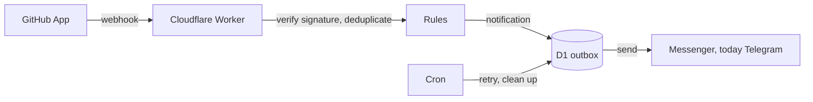

  

<h1 align="center">Seluna</h1>

  <strong>A notification on your phone when something in your GitHub repositories needs attention.</strong> 
  Self-hosted on your own free Cloudflare account, delivered through your own messenger. No central service, nothing to maintain.

  

  
  
  

## Why Seluna

Pull requests wait for a review, a build turns red, a security alert opens, and you only notice when you happen to look at GitHub. Seluna turns those moments into a notification on your phone, so the state of your repositories comes to you. Drafts stay quiet, except for a leaked secret.

- **Yours alone.** Every user runs their own instance. A private GitHub App sends webhooks to a Cloudflare Worker in your own account, which keeps its state in D1 and delivers through a messenger of your own, today a Telegram bot. No data passes through a third party.
- **Your messenger.** Telegram works today. ntfy, Gotify, Matrix and Discord are planned, and you will be able to switch between the ones you have set up.
- **Free to run.** It fits the Cloudflare free plan; D1 and Telegram cost nothing either.
- **Set up in the browser.** Click the button above, then follow the setup wizard. No command line is needed. The aim is a working setup in under 15 minutes.
- **No upkeep for new repositories.** Install the GitHub App on all your repositories and new ones are covered automatically.
- **Personal and team use.** Your own account or an organization, a private chat or a group chat. Messages come in English or German.

## What you get notified about

| Event                                                                                                 | Status    |
| ----------------------------------------------------------------------------------------------------- | --------- |
| A pull request is opened                                                                              | available |
| A draft pull request is marked ready for review                                                       | available |
| A review is requested                                                                                 | available |
| CI failed on the default branch or in a pull request                                                  | available |
| A Dependabot, code scanning or secret scanning alert is opened (code scanning: on the default branch) | available |
| A new Seluna release is available                                                                     | available |

Each message names the repository and the case, shows the title and the context (for a pull request its author and branches, for a failed CI run the branch and the first line of the commit message, for a security alert its name and severity or type) and carries a button that opens the item on GitHub. Draft pull requests trigger nothing; a leaked secret is reported even when it was pushed to a draft pull request, and the secret itself is never shown. When GitHub cannot tell in time whether a pull request with a failed CI run is a draft, the message says so. Quiet hours deliver messages without sound instead of holding them back.

## How it works

Every webhook is checked against its signature before anything happens. A delivery is processed once, a matching event is stored in the outbox before it is sent, and your messenger never calls your instance: Seluna only sends. The GitHub App credentials are stored encrypted. The details are in [`docs/ARCHITECTURE.md`](docs/ARCHITECTURE.md).

## Get started

1. Create a bot for Telegram, the first supported messenger, with [@BotFather](https://t.me/BotFather) and keep its token.
2. Choose a random `SELUNA_SECRET` of at least 32 characters. It is the password of the setup page.
3. Select **Deploy to Cloudflare** above. The button creates an independent copy of this repository in your GitHub account (not a fork) and deploys it.
4. Open `https://<your-worker>.workers.dev/setup`, sign in and let the wizard connect your Telegram chat and create the GitHub App.

The full walk-through is in the [setup guide](docs/setup.md). Every push to `main` of your copy deploys it.

## Settings

Change them on the setup page (`/setup`); they apply without a new deployment.

| Setting                                                           | Default |
| ----------------------------------------------------------------- | ------- |
| Language of the notifications (English or German)                 | English |
| Time zone                                                         | UTC     |
| Quiet hours (notifications arrive without sound)                  | off     |
| New pull request, pull request ready for review, review requested | on      |
| CI failed on the default branch, CI failed in a pull request      | on      |
| Dependabot alert, code scanning alert, secret scanning alert      | on      |
| Notice about a new Seluna release                                 | on      |

## Status

Seluna is in active development and can already notify you about pull requests, failed CI runs, security alerts and new Seluna releases. The path to 1.0.0 is planned release by release:

| Release         | What it adds                                                          |
| --------------- | --------------------------------------------------------------------- |
| 0.6.0           | A tidier setup: new look, navigation, bot token entered in the wizard |
| 0.7.0           | A channel-neutral outbox and a switchable delivery channel            |
| 1.0.0           | Setup guide with screenshots, tested by someone outside the project   |
| 1.1.0 and 1.2.0 | More channels: ntfy, Gotify, Matrix and Discord                       |

The release plan is in [`docs/CONTRIBUTING.md`](docs/CONTRIBUTING.md#release-plan-up-to-100) and the changes of each release in the [changelog](CHANGELOG.md).

## Security

Please report vulnerabilities privately, see [`SECURITY.md`](SECURITY.md).

## Contributing

How to build, test and submit a change is in [`docs/CONTRIBUTING.md`](docs/CONTRIBUTING.md).

## License

[MIT](LICENSE)
