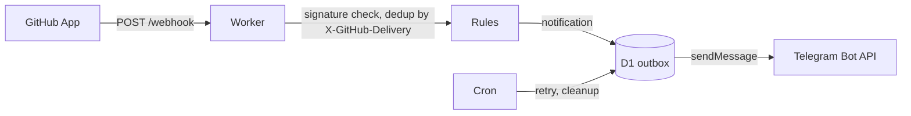

# Architecture

<!-- project:begin architecture -->
Seluna sends a Telegram message when something in the owner's GitHub repositories needs attention: a pull
request is ready, a review is requested, CI failed or a security alert was opened. Draft pull requests trigger
nothing. Every user runs their own instance — a Cloudflare Worker (free plan) in the user's own account with its
state in D1, fed by a private GitHub App and delivering through the user's own Telegram bot; there is no central
service ([decision 0005](decisions/0005-one-instance-per-user.md), TypeScript instead of Go:
[decision 0004](decisions/0004-typescript-instead-of-go.md)).

## Components

| Component | Owns |
| --------- | ---- |
| Worker `fetch` handler | `POST /webhook`, `GET /health` (returns the version), `/setup` (the setup wizard) |
| Rules | Pure functions from a parsed GitHub event to zero or one notification; no I/O, no clock |
| Outbox | The D1 `outbox` table and delivery to the Telegram Bot API, with retry |
| Setup wizard | GitHub App creation through the manifest flow ([decision 0006](decisions/0006-github-app-per-user-manifest-flow.md)), the Telegram bot token, the setup login |
| Cron (`scheduled` handler) | Every 10 minutes: retry the outbox and clean up D1. Daily: check for a new Seluna release |
| D1 | `settings`, `secrets` (AES-256-GCM), `deliveries`, `outbox`, `token_cache`, `meta` |

## Webhook to Telegram

1. GitHub sends an event to `POST /webhook`. The Worker verifies the `X-Hub-Signature-256` signature over the raw
   body; an invalid signature is rejected and nothing is stored. Without a configured webhook secret every delivery
   is answered 503, so a setup gap is told apart from a forged request
   ([decision 0012](decisions/0012-webhook-signature-verification.md)).
2. The delivery id (`X-GitHub-Delivery`) is recorded in `deliveries`; a redelivery of the same id is acknowledged
   and ignored.
3. The parsed event goes through the rules. A draft pull request, and any event no rule matches, produces nothing.
4. A matching event becomes a row in the `outbox` ([decision 0008](decisions/0008-delivery-through-a-d1-outbox.md)),
   delivery to the Telegram Bot API is attempted at once, and the cron trigger retries rows that are still pending.

Guarantees along the way (also in [`.squad/project.md`](../.squad/project.md), *Guarantees*): an invalid signature
has no effect, a delivery is processed once, a matched event is stored before it is sent, Telegram is only ever
called, never a source of input.

## Endpoints

| Endpoint | Purpose |
| -------- | ------- |
| `POST /webhook` | GitHub App events (signature checked) |
| `GET /health` | Returns the running version, fixed from `package.json` at build time |
| `/setup` | Setup wizard, behind the setup login |

Every other method and path answers 404 with an empty body; until the wizard exists, so does `/setup`. A route
that reads a request body rejects one over 1 MiB with 413, and each request is logged as method, path and status
only. The rules are in [`areas/http-routes.md`](areas/http-routes.md)
([decision 0011](decisions/0011-public-http-surface.md)).

## Cron triggers

| Schedule | Job |
| -------- | --- |
| every 10 minutes | Retry unsent `outbox` rows; clean up expired `deliveries`, `outbox` and `token_cache` rows |
| daily | Compare the running version with the latest Seluna release and record the result in `meta` |

## D1 tables

| Table | Holds |
| ----- | ----- |
| `settings` | Instance settings (for example the chat id, the notification options) |
| `secrets` | GitHub App credentials and the Telegram bot token, AES-256-GCM ciphertext |
| `deliveries` | Processed `X-GitHub-Delivery` ids, for deduplication |
| `outbox` | Notifications waiting for, or past, delivery |
| `token_cache` | Short-lived GitHub installation tokens |
| `meta` | Schema version and the result of the release check |

## Configuration

Settings are stored in D1 (`settings`) and written by the setup wizard; the values outside D1 are two
Worker secrets, the encryption key and the optional `GITHUB_WEBHOOK_SECRET` (the webhook secret until the
setup wizard stores it in D1), plus the D1 binding in `wrangler.jsonc`. The rules per area are in
[`areas/`](areas/README.md).

## Security model

The webhook is authenticated by its HMAC signature, the setup wizard by the setup login, and the Worker only
calls out (GitHub API, Telegram Bot API). The GitHub App has the minimum permissions the rules need, and its
credentials are encrypted in D1 ([decision 0007](decisions/0007-github-app-credentials-encrypted-in-d1.md)).
The concrete areas are listed in [`.squad/project.md`](../.squad/project.md) (*Security areas*) and
[`SECURITY.md`](../SECURITY.md).

## Deployment

Wrangler bundles the Worker (`npm run build` is `wrangler deploy --dry-run --outdir dist`); a user deploys it to
their own Cloudflare account. A release is created only by pushing a `v*` tag, which the release workflow
(`.github/workflows/release.yml`) verifies before it publishes
([decision 0009](decisions/0009-releases-only-by-tag-push.md)).
<!-- project:end architecture -->

## Development process

This repository is developed with Claude Code: `CLAUDE.md` holds the rules (mirrored for GitHub Copilot in
`.github/copilot-instructions.md`), the skills live under `.claude/skills/` and the squad roles under
`.claude/agents/`. Every pull request is reviewed before it is opened by the read-only reviewer in `.claude/agents/squad-reviewer.md`
— round 1 is a full review, every later round looks only at the delta, and only blocking findings earn
another round, because a fresh full re-review of unchanged code always finds something new.

The squad skills (`squad-issue`, `squad-spec`) wrap that review in a larger, bounded pipeline described in
[`.squad/routing.md`](../.squad/routing.md): an Opus Lead plans, classifies the change into a tier (`docs`,
`patch`, `trivial`, `standard`, `security`) that decides how much of the pipeline runs, and owns every decision;
for `standard` and `security` plans that weigh options a Devil's Advocate challenges the plan once (no veto); on
the `security` tier a Security member reviews the plan (in parallel with the challenge) and the diff, below it the Reviewer carries the security checklist; tests are
written first and new/changed code is covered until the *Coverage gate* passes; a Code Officer clears formatting
and analyzer diagnostics *before* the review so the reviewed code is the merged code; and the review loop
is one full pass plus at most two delta rounds; the pull request is approved by a checklist the orchestrating
session runs, and the Lead is asked only for what is open. Every limit ends in a Lead decision, and only a
decision the Lead cannot make reaches the human. The stack-specific commands live in
[`.squad/stack.md`](../.squad/stack.md), the project's guarantees and attack surface in
[`.squad/project.md`](../.squad/project.md).

The reasoning behind individual choices is kept out of this document and recorded instead as decision
records in [`docs/decisions/`](decisions/README.md); this document describes how the system works and
links a record where a guarantee or flow is the result of one.
