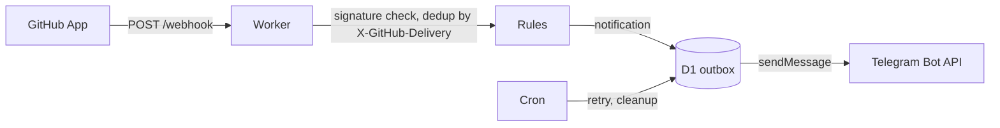

# Architecture

<!-- project:begin architecture -->
Seluna sends a Telegram message when something in the owner's GitHub repositories needs attention: a pull
request is ready, a review is requested, CI failed or a security alert was opened. Draft pull requests trigger
nothing. Every user runs their own instance — a Cloudflare Worker (free plan) in the user's own account with its
state in D1, fed by a private GitHub App and delivering through the user's own Telegram bot; there is no central
service ([decision 0005](decisions/0005-one-instance-per-user.md), TypeScript instead of Go:
[decision 0004](decisions/0004-typescript-instead-of-go.md)).

## Components

| Component | Owns |
| --------- | ---- |
| Worker `fetch` handler | `POST /webhook`, `GET /health` (returns the version), `/setup` (the setup wizard) |
| Webhook processing | Deduplication by `X-GitHub-Delivery`, the rules, the outbox rows and the first send attempt of each row ([`areas/notifications.md`](areas/notifications.md), [decision 0023](decisions/0023-webhook-processing-and-delivery-through-the-outbox.md)) |
| Rules | Pure functions of the event name, the payload and the settings to zero or one notification; no I/O, no clock |
| Outbox | The D1 `outbox` table holding each message as rendered Telegram HTML, and delivery to the Telegram Bot API, with one retry after a 429 and the cron's retry |
| Setup wizard | GitHub App creation through the manifest flow ([decision 0006](decisions/0006-github-app-per-user-manifest-flow.md), [decision 0017](decisions/0017-github-app-manifest-flow.md)), the Telegram chat, the setup login, the status page with the settings and the reset after a changed `SELUNA_SECRET` ([decision 0018](decisions/0018-settings-and-status-page.md)) |
| Cron (`scheduled` handler) | Every 10 minutes: retry the outbox and clean up D1. Daily: check for a new Seluna release |
| D1 (`src/store/`) | `settings`, `secrets` (AES-256-GCM), `deliveries`, `outbox`, `token_cache` (AES-256-GCM), `meta`; the only code that reads or writes D1 |

## Webhook to Telegram

1. GitHub sends an event to `POST /webhook`. The Worker verifies the `X-Hub-Signature-256` signature over the raw
   body; an invalid signature is rejected and nothing is stored. The secret is the Worker secret
   `GITHUB_WEBHOOK_SECRET` when it is set, else the one the setup wizard stored in D1. Without a usable webhook secret
   (or when reading it fails) every delivery is answered 503, so a setup gap is told apart from a forged request
   ([decision 0012](decisions/0012-webhook-signature-verification.md),
   [decision 0017](decisions/0017-github-app-manifest-flow.md)).
2. A delivery id (`X-GitHub-Delivery`) that `deliveries` already holds is answered 200 and ignored.
3. The payload goes through the rules, each a pure function of event name, payload and settings. A draft pull
   request, and any event no rule matches, produces nothing
   ([decision 0024](decisions/0024-pull-request-rules.md)).
4. In one D1 transaction the delivery id is recorded in `deliveries`, each notification becomes a row in the
   `outbox` as escaped Telegram HTML ([decision 0008](decisions/0008-delivery-through-a-d1-outbox.md)) and `meta`
   records the time of the delivery; then the Worker answers 202. Delivery to the Telegram Bot API is attempted
   right after the answer (`waitUntil`), once more after a short 429 wait, and the cron trigger retries rows that are
   still pending. The rules per step are in [`areas/notifications.md`](areas/notifications.md)
   ([decision 0023](decisions/0023-webhook-processing-and-delivery-through-the-outbox.md)).

Guarantees along the way (also in [`.squad/project.md`](../.squad/project.md), *Guarantees*): an invalid signature
has no effect, a delivery is processed once, a matched event is stored before it is sent, and Telegram never calls
the Worker: it has no webhook and no route, the Worker calls only `getUpdates` and `sendMessage`, and the input it
takes from Telegram is the `getUpdates` answer of the setup wizard's signed-in Telegram step and the status of each
`sendMessage` answer (for a 429 also its `retry_after`), both read bounded and narrowed; a chat is stored only after the owner typed back the code of
its test message ([decision 0016](decisions/0016-telegram-chat-in-the-setup-wizard.md)).

## Endpoints

| Endpoint | Purpose |
| -------- | ------- |
| `POST /webhook` | GitHub App events (signature checked) |
| `GET /health` | Returns the running version, fixed from `package.json` at build time |
| `/setup` | Setup wizard, behind the setup login |

Every other method and path answers 404 with an empty body. Under `/setup` the setup login decides first: without
a valid session every request gets the login page, and without a usable `SELUNA_SECRET` the wizard refuses to start
([`areas/setup-wizard.md`](areas/setup-wizard.md), [decision 0015](decisions/0015-setup-login.md)). A route
that reads a request body rejects one over 1 MiB with 413, and each request is logged as method, path and status
only. The rules are in [`areas/http-routes.md`](areas/http-routes.md)
([decision 0011](decisions/0011-public-http-surface.md)).

## Cron triggers

| Schedule | Job |
| -------- | --- |
| every 10 minutes | Retry unsent `outbox` rows; clean up expired `deliveries`, `outbox` and `token_cache` rows |
| daily | Compare the running version with the latest Seluna release and record the result in `meta` |

## D1 tables

| Table | Holds |
| ----- | ----- |
| `settings` | Instance settings (for example the chat id, the notification options) |
| `secrets` | GitHub App credentials, AES-256-GCM ciphertext |
| `deliveries` | Processed `X-GitHub-Delivery` ids, for deduplication |
| `outbox` | Notifications waiting for, or past, delivery |
| `token_cache` | Short-lived GitHub installation tokens, AES-256-GCM ciphertext |
| `meta` | The last notified release, the time of the last delivery, the key check value that detects a changed `SELUNA_SECRET`, the setup login's failed-attempt count and the slug of the GitHub App the setup wizard created |

All six tables come from the first migration; only the modules under `src/store/` access them. The key for the
encrypted columns is derived from `SELUNA_SECRET` and never stored, so a reader of the database alone learns no
credential. Columns, formats and the key check are in [`areas/storage.md`](areas/storage.md)
([decision 0007](decisions/0007-github-app-credentials-encrypted-in-d1.md),
[decision 0014](decisions/0014-d1-schema-and-data-access.md)).

## Configuration

Settings are stored in D1 (`settings`), written by the setup wizard and read on every use, so a change takes effect
without a deployment ([decision 0018](decisions/0018-settings-and-status-page.md)); the values outside D1 are Worker
secrets — `SELUNA_SECRET` (the password of the setup login and the source of the encryption and signing keys) and `TELEGRAM_BOT_TOKEN`, both asked for by the
deploy form, the optional `GITHUB_APP_ID`, `GITHUB_APP_PRIVATE_KEY` and `GITHUB_WEBHOOK_SECRET` (a GitHub App set by hand; each
takes precedence over the credential of the same name that the setup wizard stores in D1,
[decision 0017](decisions/0017-github-app-manifest-flow.md)) and the optional `TELEGRAM_CHAT_ID` (takes precedence over the chat the setup wizard stores,
[decision 0016](decisions/0016-telegram-chat-in-the-setup-wizard.md)) — plus the D1 binding `DB` and the cron triggers in `wrangler.jsonc`
([decision 0013](decisions/0013-deploy-to-cloudflare-and-workers-builds.md)). The rules per area are in
[`areas/`](areas/README.md).

## Security model

The webhook is authenticated by its HMAC signature, the setup wizard by the setup login
([decision 0015](decisions/0015-setup-login.md)), and the Worker only calls out (GitHub API, Telegram Bot API); the
Telegram chat list it reads in the setup wizard is bounded, narrowed and shown only to the signed-in owner, who
saves a chat only by typing back the code its test message carried
([decision 0016](decisions/0016-telegram-chat-in-the-setup-wizard.md)). The GitHub App has the minimum permissions the rules need, and its
credentials are encrypted in D1 ([decision 0007](decisions/0007-github-app-credentials-encrypted-in-d1.md)). The setup
wizard creates that app through GitHub's manifest flow: the `state` that travels through GitHub is bound to the
owner's session and to the account the owner chose, the app GitHub returns must belong to that account before
anything is stored, the answer of GitHub's API (the Worker's one call to it, unauthenticated) is read bounded and
narrowed, and the three credentials are stored together or not at all
([decision 0017](decisions/0017-github-app-manifest-flow.md)).
The concrete areas are listed in [`.squad/project.md`](../.squad/project.md) (*Security areas*) and
[`SECURITY.md`](../SECURITY.md).

## Deployment

Wrangler bundles the Worker (`npm run build` is `wrangler deploy --dry-run --outdir dist`). A user deploys it to
their own Cloudflare account with the Deploy to Cloudflare button, which copies the repository into the user's
GitHub account, provisions the D1 database and asks for the Worker secrets; from then on every push to `main` of
that copy starts a Workers Build whose deploy command, `npm run deploy`, applies the D1 migrations and then deploys
(the setup guide has the user check that command, which the button does not always set)
([decision 0013](decisions/0013-deploy-to-cloudflare-and-workers-builds.md), [decision 0020](decisions/0020-deploy-command-checked-in-the-setup-guide.md), rules in
[`areas/deployment.md`](areas/deployment.md)). A release is published on GitHub as a pre-release with its `v*` tag on `main`; the release workflow
(`.github/workflows/release.yml`) verifies the tagged commit and only then turns it into the latest full release
([decision 0009](decisions/0009-releases-only-by-tag-push.md)).
<!-- project:end architecture -->

## Development process

This repository is developed with Claude Code: `AGENTS.md` holds the rules every AI coding agent reads
(imported by `CLAUDE.md`, mirrored for GitHub Copilot in `.github/copilot-instructions.md`), the skills
live under `.claude/skills/` and the squad roles under `.claude/agents/`. Every pull request is reviewed before it is opened by the read-only reviewer in `.claude/agents/squad-reviewer.md`
— round 1 is a full review, every later round looks only at the delta, and only blocking findings earn
another round, because a fresh full re-review of unchanged code always finds something new.

The squad skills (`squad-issue`, `squad-spec`) wrap that review in a larger, bounded pipeline described in
[`.squad/routing.md`](../.squad/routing.md): an Opus Lead plans, classifies the change into a tier (`docs`,
`patch`, `trivial`, `standard`, `security`) that decides how much of the pipeline runs, and owns every decision;
for `standard` and `security` plans that weigh options a Devil's Advocate challenges the plan once (no veto); on
the `security` tier a Security member reviews the plan (in parallel with the challenge) and the diff, below it the Reviewer carries the security checklist; tests are
written first and new/changed code is covered until the *Coverage gate* passes; the member that changed the files
formats them and a Code Officer clears analyzer diagnostics *before* the review so the reviewed code is the merged code; and the review loop
is one full pass plus at most two delta rounds; the pull request is approved by a checklist the orchestrating
session runs, and the Lead is asked only for what is open. Every limit ends in a Lead decision, and only a
decision the Lead cannot make reaches the human. The stack-specific commands live in
[`.squad/stack.md`](../.squad/stack.md), the project's guarantees and attack surface in
[`.squad/project.md`](../.squad/project.md).

The reasoning behind individual choices is kept out of this document and recorded instead as decision
records in [`docs/decisions/`](decisions/README.md); this document describes how the system works and
links a record where a guarantee or flow is the result of one.
