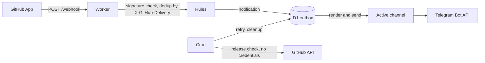

# Architecture

<!-- project:begin architecture -->
Seluna sends a Telegram message when something in the owner's GitHub repositories needs attention: a pull
request is ready, a review is requested, CI failed, a security alert was opened, or an issue or comment was written by someone else. Draft pull requests trigger
nothing; the exceptions are a CI failure in a pull request whose draft state could not be read (failure or no answer within 8 seconds),
reported marked _draft status unknown_ ([decision 0027](decisions/0027-ci-failure-rules-and-the-draft-lookup.md)), and a
secret scanning alert, which is reported whatever its source, a draft pull request's branch or text included
([decision 0028](decisions/0028-security-alert-rules.md)). Every user runs their own instance — a Cloudflare Worker (free plan) in the user's own account with its
state in D1, fed by a private GitHub App and delivering through the user's own Telegram bot; there is no central
service ([decision 0005](decisions/0005-one-instance-per-user.md), TypeScript instead of Go:
[decision 0004](decisions/0004-typescript-instead-of-go.md)).

## Components

| Component | Owns |
| --------- | ---- |
| Worker `fetch` handler | `POST /webhook`, `GET /health` (returns the version), `/setup` (the setup wizard), `GET /` (redirects to `/setup`) |
| Webhook processing | Deduplication by `X-GitHub-Delivery`, the owner read, the rules, the draft lookup of a CI failure in a pull request ([decision 0027](decisions/0027-ci-failure-rules-and-the-draft-lookup.md)) or of a comment on a pull request, the outbox rows and the first send attempt of each row ([`areas/notifications.md`](areas/notifications.md), [decision 0023](decisions/0023-webhook-processing-and-delivery-through-the-outbox.md)) |
| GitHub API client | Calls of the GitHub API as the app: the app JWT, the installation tokens per `installation.id` cached encrypted in `token_cache`, the pull request read for the draft lookup of the webhook processing (with tokens narrowed to the permissions of that one call), and the app read and the installations list for the status page ([`areas/github-api.md`](areas/github-api.md), [decision 0026](decisions/0026-github-app-authentication-and-installation-tokens.md)) |
| Rules | Pure functions of the event name, the payload, the settings and the stored app owner (read by the webhook processing) to zero or one notification; no I/O, no clock |
| Outbox and delivery channels | The D1 `outbox` table holding each message as a channel-neutral notification (JSON in `text`, no migration), and delivery through the one active delivery channel (`src/channels/`; Telegram is the first adapter, over the shared HTTP code of `src/channels/http.ts`), which renders the notification when it sends it, with one retry after a 429 and the cron's retry ([`areas/notifications.md`](areas/notifications.md), [decision 0038](decisions/0038-channel-neutral-outbox-and-active-delivery-channel.md)) |
| Setup wizard | GitHub App creation through the manifest flow ([decision 0006](decisions/0006-github-app-per-user-manifest-flow.md), [decision 0017](decisions/0017-github-app-manifest-flow.md)), the Telegram bot token ([decision 0036](decisions/0036-telegram-bot-token-in-the-setup-wizard.md)) and chat, the setup login, the Messengers card that activates a delivery channel, the status page with the settings, the app's installations and the reset after a changed `SELUNA_SECRET` ([decision 0018](decisions/0018-settings-and-status-page.md)) |
| Cron (`scheduled` handler) | Every 10 minutes: clean up D1 and retry the outbox up to the fifth attempt. Daily: check for a new Seluna release and send a notice ([`areas/scheduled-jobs.md`](areas/scheduled-jobs.md), [decision 0029](decisions/0029-outbox-retry-and-cleanup-by-the-cron.md), [decision 0030](decisions/0030-release-notice-without-credentials.md)) |
| D1 (`src/store/`) | `settings`, `secrets` (AES-256-GCM), `deliveries`, `outbox`, `token_cache` (AES-256-GCM), `meta`; the only code that reads or writes D1 |

## Webhook to Telegram

1. GitHub sends an event to `POST /webhook`. The Worker verifies the `X-Hub-Signature-256` signature over the raw
   body; an invalid signature is rejected and nothing is stored. The secret is the Worker secret
   `GITHUB_WEBHOOK_SECRET` when it is set, else the one the setup wizard stored in D1. Without a usable webhook secret
   (or when reading it fails) every delivery is answered 503, so a setup gap is told apart from a forged request
   ([decision 0012](decisions/0012-webhook-signature-verification.md),
   [decision 0017](decisions/0017-github-app-manifest-flow.md)).
2. A delivery id (`X-GitHub-Delivery`) that `deliveries` already holds is answered 200 and ignored.
3. The payload goes through the rules, each a pure function of event name, payload, settings and the stored app owner (read once per delivery). A draft pull
   request, and any event no rule matches, produces nothing
   ([decision 0024](decisions/0024-pull-request-rules.md)). A failed CI run in a pull request names the pull request
   only by number, so the processing asks GitHub, as the app and within 8 seconds, whether it is a draft: a draft
   produces nothing, and a pull request whose draft state could not be read is reported marked _draft status unknown_
   ([decision 0027](decisions/0027-ci-failure-rules-and-the-draft-lookup.md)).
   New and reopened security alerts (Dependabot, code scanning on the default branch, secret scanning) are reported
   from the payload alone; no part of a secret reaches a message
   ([decision 0028](decisions/0028-security-alert-rules.md)).
   A new issue and a comment on an issue or a pull request are reported unless the owner or a bot wrote them; a
   comment on a draft pull request, or one whose draft state stays unknown, produces nothing
   ([decision 0040](decisions/0040-issue-and-comment-rules.md)).
4. In one D1 transaction the delivery id is recorded in `deliveries`, each notification becomes a row in the
   `outbox` as a cleaned, channel-neutral JSON notification ([decision 0008](decisions/0008-delivery-through-a-d1-outbox.md),
   [decision 0038](decisions/0038-channel-neutral-outbox-and-active-delivery-channel.md)) and `meta`
   records the time of the delivery; then the Worker answers 202. The active delivery channel (the setting
   `delivery_channel`, Telegram by default, read once per batch, no fallback) renders each row when it sends it; for
   Telegram that is escaped HTML, sent to the Bot API right after the answer (`waitUntil`), once more after a short 429 wait, and the cron trigger retries rows that are
   still pending; the fifth failed attempt marks a row failed, and it is not sent again
   ([decision 0029](decisions/0029-outbox-retry-and-cleanup-by-the-cron.md)). A message sent during the owner's quiet hours is sent at once, without sound
   ([decision 0025](decisions/0025-quiet-hours-decided-at-sending.md)). The rules per step are in
   [`areas/notifications.md`](areas/notifications.md) ([decision 0023](decisions/0023-webhook-processing-and-delivery-through-the-outbox.md)).

Guarantees along the way (also in [`.squad/project.md`](../.squad/project.md), *Guarantees*): an invalid signature
has no effect, a delivery is processed once (within the 7 days its `deliveries` row is kept), a matched event is stored before it is sent, and Telegram never calls
the Worker: it has no webhook and no route, the Worker calls only `getMe`, `getUpdates` and `sendMessage`, and the
input it takes from Telegram is the status and `ok` of the `getMe` answer and the `getUpdates` answer of the setup
wizard's signed-in Telegram step and the status of each `sendMessage` answer (for a 429 also its `retry_after`), all
read bounded and narrowed ([decision 0036](decisions/0036-telegram-bot-token-in-the-setup-wizard.md)); a chat is stored only after the owner typed back the code of
its test message ([decision 0016](decisions/0016-telegram-chat-in-the-setup-wizard.md)).

## Endpoints

| Endpoint | Purpose |
| -------- | ------- |
| `POST /webhook` | GitHub App events (signature checked) |
| `GET /health` | Returns the running version, fixed from `package.json` at build time |
| `/setup` | Setup wizard, behind the setup login |
| `GET /`, `HEAD /` | Redirects to `/setup` |

Every other method and path answers 404 with an empty body. Under `/setup` the setup login decides first: without
a valid session every request gets the login page, and without a usable `SELUNA_SECRET` the wizard refuses to start
([`areas/setup-wizard.md`](areas/setup-wizard.md), [decision 0015](decisions/0015-setup-login.md)). A route
that reads a request body rejects one over 1 MiB with 413, and each request is logged as method, path and status
only. The rules are in [`areas/http-routes.md`](areas/http-routes.md)
([decision 0011](decisions/0011-public-http-surface.md), the root redirect:
[decision 0035](decisions/0035-root-url-redirects-to-setup.md)).

## Cron triggers

| Schedule | Job |
| -------- | --- |
| every 10 minutes | Delete `deliveries` rows older than 7 days, `sent` and `failed` `outbox` rows older than 30 days and expired `token_cache` rows; then resend up to 10 `pending` `outbox` rows and mark a row `failed` after its fifth attempt ([decision 0029](decisions/0029-outbox-retry-and-cleanup-by-the-cron.md)) |
| daily | Unless the update notice is off, read the latest Seluna release without credentials and, when it is newer than the running and the remembered version, write and send a notice and remember the version in `meta` ([decision 0030](decisions/0030-release-notice-without-credentials.md)) |

Each job catches its own failures and logs only a fixed result; the rules are in
[`areas/scheduled-jobs.md`](areas/scheduled-jobs.md).

## D1 tables

| Table | Holds |
| ----- | ----- |
| `settings` | Instance settings (for example the chat id, the active delivery channel, the notification options) |
| `secrets` | GitHub App credentials and the Telegram bot token entered in the setup wizard, AES-256-GCM ciphertext |
| `deliveries` | Processed `X-GitHub-Delivery` ids, for deduplication |
| `outbox` | Notifications waiting for, or past, delivery; `text` holds the notification as JSON (rows of earlier versions: Telegram HTML) |
| `token_cache` | Short-lived GitHub installation tokens, AES-256-GCM ciphertext |
| `meta` | The last notified release, the time of the last delivery, the key check value that detects a changed `SELUNA_SECRET`, the setup login's failed-attempt count, the slug of the GitHub App the setup wizard created and the owner of the GitHub App |

All six tables come from the first migration; only the modules under `src/store/` access them. The key for the
encrypted columns is derived from `SELUNA_SECRET` and never stored, so a reader of the database alone learns no
credential. Columns, formats and the key check are in [`areas/storage.md`](areas/storage.md)
([decision 0007](decisions/0007-github-app-credentials-encrypted-in-d1.md),
[decision 0014](decisions/0014-d1-schema-and-data-access.md)).

## Configuration

Settings are stored in D1 (`settings`), written by the setup wizard and read on every use, so a change takes effect
without a deployment ([decision 0018](decisions/0018-settings-and-status-page.md)); the values outside D1 are Worker
secrets — `SELUNA_SECRET` (the password of the setup login and the source of the encryption and signing keys), the only
one the deploy form asks for, the optional `TELEGRAM_BOT_TOKEN` (takes precedence over the bot token the setup wizard
stores encrypted in D1, [decision 0036](decisions/0036-telegram-bot-token-in-the-setup-wizard.md)), the optional `GITHUB_APP_ID`, `GITHUB_APP_PRIVATE_KEY` and `GITHUB_WEBHOOK_SECRET` (a GitHub App set by hand; each
takes precedence over the credential of the same name that the setup wizard stores in D1,
[decision 0017](decisions/0017-github-app-manifest-flow.md)) and the optional `TELEGRAM_CHAT_ID` (takes precedence over the chat the setup wizard stores,
[decision 0016](decisions/0016-telegram-chat-in-the-setup-wizard.md)) — plus the D1 binding `DB` and the cron triggers in `wrangler.jsonc`
([decision 0013](decisions/0013-deploy-to-cloudflare-and-workers-builds.md)). The rules per area are in
[`areas/`](areas/README.md).

## Security model

The webhook is authenticated by its HMAC signature, the setup wizard by the setup login
([decision 0015](decisions/0015-setup-login.md)), and the Worker only calls out (GitHub API, Telegram Bot API); the
Telegram chat list it reads in the setup wizard is bounded, narrowed and shown only to the signed-in owner, who
saves a chat only by typing back the code its test message carried
([decision 0016](decisions/0016-telegram-chat-in-the-setup-wizard.md)). The GitHub App has the minimum permissions the rules need, and its
credentials are encrypted in D1 ([decision 0007](decisions/0007-github-app-credentials-encrypted-in-d1.md)), as is a
bot token entered in the setup wizard, which is saved only after Telegram's `getMe` accepted it
([decision 0036](decisions/0036-telegram-bot-token-in-the-setup-wizard.md)). The setup
wizard creates that app through GitHub's manifest flow: the `state` that travels through GitHub is bound to the
owner's session and to the account the owner chose, the app GitHub returns must belong to that account before
anything is stored, the answer of the conversion (one of the Worker's two unauthenticated GitHub calls) is read bounded and
narrowed, and the three credentials are stored together or not at all
([decision 0017](decisions/0017-github-app-manifest-flow.md)). The other unauthenticated call is the daily release
check: one request to a fixed URL of the upstream repository with no credential, read bounded, narrowed to a
`tag_name` of the strict form `vA.B.C`, and the notice built from the parsed numbers only
([decision 0030](decisions/0030-release-notice-without-credentials.md)). Every other GitHub call is made as the app: a JWT
signed with the private key for each call that needs one (one per status page view for both of its requests), never stored, and per installation a token, requested with only the permissions the pull request read needs, that is cached
only encrypted and dropped when GitHub refuses it; what enters a URL is allow-listed, redirects are not followed and
every answer is read bounded and narrowed; the signed-in status page calls GitHub (the app and its installations, under one JWT), and so does the webhook processing
for the draft state of a pull request with a failed CI run or a comment, with the installation of the signed delivery
([decision 0026](decisions/0026-github-app-authentication-and-installation-tokens.md)).
The concrete areas are listed in [`.squad/project.md`](../.squad/project.md) (*Security areas*) and
[`SECURITY.md`](../SECURITY.md).

## Deployment

Wrangler bundles the Worker (`npm run build` is `wrangler deploy --dry-run --outdir dist`). A user deploys it to
their own Cloudflare account with the Deploy to Cloudflare button, which copies the repository into the user's
GitHub account, provisions the D1 database and asks for the Worker secret `SELUNA_SECRET`; from then on every push to `main` of
that copy starts a Workers Build whose deploy command, `npm run deploy`, applies the D1 migrations and then deploys
(the setup guide has the user check that command, which the button does not always set)
([decision 0013](decisions/0013-deploy-to-cloudflare-and-workers-builds.md), [decision 0020](decisions/0020-deploy-command-checked-in-the-setup-guide.md), rules in
[`areas/deployment.md`](areas/deployment.md)). A release is published on GitHub as a pre-release with its `v*` tag on `main`; the release workflow
(`.github/workflows/release.yml`) verifies the tagged commit and only then turns it into the latest full release
([decision 0009](decisions/0009-releases-only-by-tag-push.md)). The owner applies a release to the copy with the
update workflow (`.github/workflows/update.yml`), started by hand in the copy's GitHub Actions: it pushes the latest
full release as one new commit on `main`, keeping the copy's own changes and workflow files, and Workers Builds
deploys that push like any other ([decision 0031](decisions/0031-update-workflow-for-copies.md), rules in
[`areas/deployment.md`](areas/deployment.md#update)).
<!-- project:end architecture -->

## Development process

This repository is developed with Claude Code: `AGENTS.md` holds the rules every AI coding agent reads, the
skills live under `.claude/skills/` and the squad roles under `.claude/agents/`. Every pull request is reviewed
before it is opened by the read-only reviewer in `.claude/agents/squad-reviewer.md`. The squad skills
(`squad-issue`, `squad-spec`) wrap that review in a bounded pipeline described in
[`.squad/routing.md`](../.squad/routing.md): a Lead plans, picks the tier that decides how much of the pipeline
runs and owns every decision; a Devil's Advocate challenges a feature's spec and, when routing says so, the
plan; Security reviews the plan when a security area is touched; tests come first, the gates run before the
review, and every loop limit ends in a Lead decision — only one the Lead cannot make reaches the human. The stack's commands live in
[`.squad/stack.md`](../.squad/stack.md), the project's guarantees and attack surface in
[`.squad/project.md`](../.squad/project.md).

The reasoning behind individual choices is kept out of this document and recorded instead as decision
records in [`docs/decisions/`](decisions/README.md); this document describes how the system works and
links a record where a guarantee or flow is the result of one.
