# Einrichtung

English: [Setup guide](setup.md)

So richtest du deine eigene Seluna-Instanz ein, in deinem Webbrowser und mit der Telegram-App auf deinem Handy. Du tippst keinen Befehl. Wenn ein Schritt nicht klappt, findest du dein Problem in der [Fehlerbehebung](troubleshooting.md) (englisch).

## Was du brauchst

- Einen Desktop-Webbrowser und die Telegram-App auf deinem Handy.
- Ein kostenloses Konto bei [GitHub](https://github.com/signup), bei [Cloudflare](https://dash.cloudflare.com/sign-up) und bei [Telegram](https://telegram.org/). Diese Anleitung geht von einem persönlichen GitHub-Konto aus.
- Einen Passwortmanager oder einen anderen Ort, an dem du ein langes zufälliges Passwort aufbewahren kannst.

## 1. Telegram-Bot erstellen

Seluna sendet seine Benachrichtigungen über einen eigenen Telegram-Bot.

1. Öffne in Telegram [@BotFather](https://t.me/BotFather) und sende `/newbot`.
2. Beantworte seine Fragen: ein Name für den Bot, dann ein Benutzername, der auf `bot` endet.
3. Kopiere den Token, den @BotFather zurückgibt, und bewahre ihn für Schritt 5 auf. Behandle ihn wie ein Passwort.
4. Öffne deinen neuen Bot und sende ihm `/start`. Der Bot antwortet nicht: Seluna sendet nur Nachrichten, es antwortet nie in Telegram.

Telegram beschreibt diesen Schritt in seiner [Dokumentation zu @BotFather](https://core.telegram.org/bots/features#botfather) (englisch).

**Es hat geklappt, wenn** @BotFather dir eine Nachricht mit dem Token des Bots geschickt hat.

## 2. SELUNA_SECRET erstellen

`SELUNA_SECRET` ist das Passwort der Einrichtungsseite deiner Instanz, und aus ihm entsteht der Schlüssel, der die von Seluna gespeicherten Zugangsdaten verschlüsselt.

1. Erzeuge in deinem Passwortmanager ein zufälliges Passwort mit mindestens 32 Zeichen, zum Beispiel 40 Buchstaben und Ziffern. Ein kürzeres wird abgelehnt.
2. Speichere es im Passwortmanager, zum Beispiel als Eintrag „Seluna“.

Bewahre es auf: Wenn du es später änderst, kann Seluna das Gespeicherte nicht mehr lesen, und du musst Teile der Einrichtung wiederholen ([Fehlerbehebung](troubleshooting.md#i-changed-the-seluna_secret)).

**Es hat geklappt, wenn** du ein zufälliges Passwort mit mindestens 32 Zeichen in deinem Passwortmanager gespeichert hast.

## 3. Bei Cloudflare bereitstellen

1. Öffne die [README](../README.md) und wähle **Deploy to Cloudflare**.
2. Melde dich bei Cloudflare an. Das Formular bittet dich, dein GitHub-Konto zu verbinden, damit es dort ein neues privates Repository mit einer Kopie von Seluna anlegen kann (eine eigenständige Kopie, kein Fork). Cloudflare beschreibt das in seiner [Dokumentation zu Deploy-Buttons](https://developers.cloudflare.com/workers/platform/deploy-buttons/) (englisch).
3. Behalte den Projektnamen `seluna`, lass das Formular eine neue D1-Datenbank anlegen und nenne sie `seluna`, und lass den Standort auf automatisch. Füge das Passwort aus Schritt 2 dort ein, wo das Formular nach `SELUNA_SECRET` fragt, und fahre fort, bis Cloudflare den Worker baut und bereitstellt.
4. Prüfe nach dem Deploy den Deploy-Befehl in den Build-Einstellungen des Workers. Dort muss `npm run deploy` stehen; das legt die Datenbanktabellen an, bevor es den Worker bereitstellt. Der Button setzt manchmal stattdessen `npx wrangler deploy`; ändere es dann auf `npm run deploy` und wiederhole den letzten Build. Cloudflare beschreibt die Build-Einstellungen in seiner [Dokumentation zur Build-Konfiguration](https://developers.cloudflare.com/workers/ci-cd/builds/configuration/) (englisch).
5. Notiere die Adresse deines Workers, `https://<worker>.<dein-subdomain>.workers.dev`; die Seite des Workers im Cloudflare-Dashboard zeigt sie.

Teste Seluna nicht in dieser Kopie des Repositorys: Jeder Merge in ihren `main`-Branch stellt deine Instanz neu bereit.

**Es hat geklappt, wenn** das Build-Protokoll des letzten Builds die Zeile `> wrangler d1 migrations apply DB --remote` zeigt und `https://<worker>.<dein-subdomain>.workers.dev/health` mit der Version von Seluna antwortet.

## 4. Einrichtungsseite öffnen und anmelden

1. Öffne `https://<worker>.<dein-subdomain>.workers.dev/` in deinem Browser. Die Adresse führt zur Einrichtungsseite. Die Links oben rechts, **English** und **Deutsch**, schalten die Sprache der Seiten um.
2. Gib dein `SELUNA_SECRET` in das Feld **SELUNA_SECRET** ein und wähle **Anmelden**.

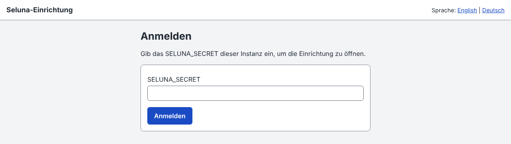

Wenn du dich fünfmal falsch anmeldest, ist die Anmeldung 15 Minuten lang gesperrt ([Fehlerbehebung](troubleshooting.md#signing-in-is-locked)).

**Es hat geklappt, wenn** die Seite „Du bist angemeldet“ mit den Karten **Status** und **Messenger** und den Links **Telegram-Chat** und **GitHub-App** erscheint.

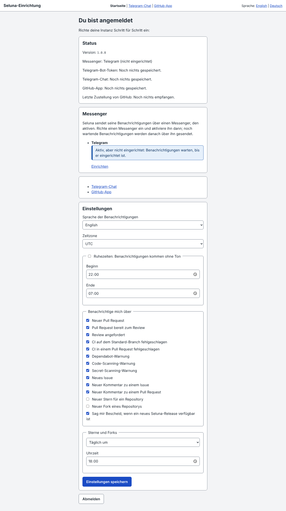

## 5. Telegram-Chat verbinden

Wähle oben auf der Seite **Telegram-Chat**.

1. Gib den Bot-Token aus Schritt 1 in das Feld **Bot-Token** ein und wähle **Token speichern**. Seluna prüft den Token bei Telegram und speichert ihn verschlüsselt; er wird nicht wieder angezeigt.

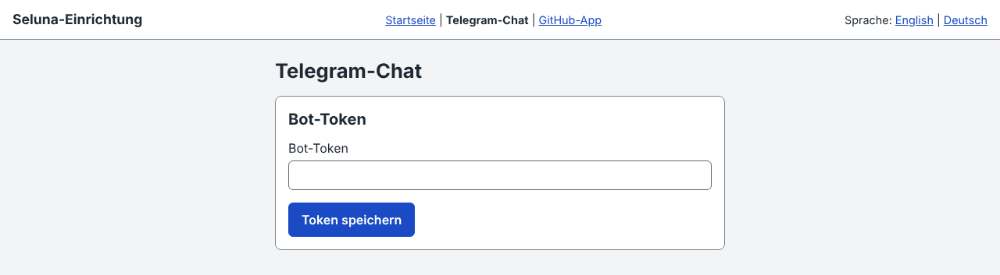

2. Der Schritt listet nun die Chats auf, die dein Bot gesehen hat. Dein eigener Chat, so benannt wie in Telegram und als **Privatchat** gekennzeichnet, erscheint, weil du in Schritt 1 `/start` gesendet hast. Ist die Liste leer (die Seite sagt dann _Kein Chat gefunden_), sende deinem Bot erneut `/start` und wähle **Nach Chats suchen**. Jeder, der deinem Bot schreibt, erscheint hier; wähle also nur deinen eigenen Chat.
3. Wähle deinen Chat und wähle **Testnachricht senden**.

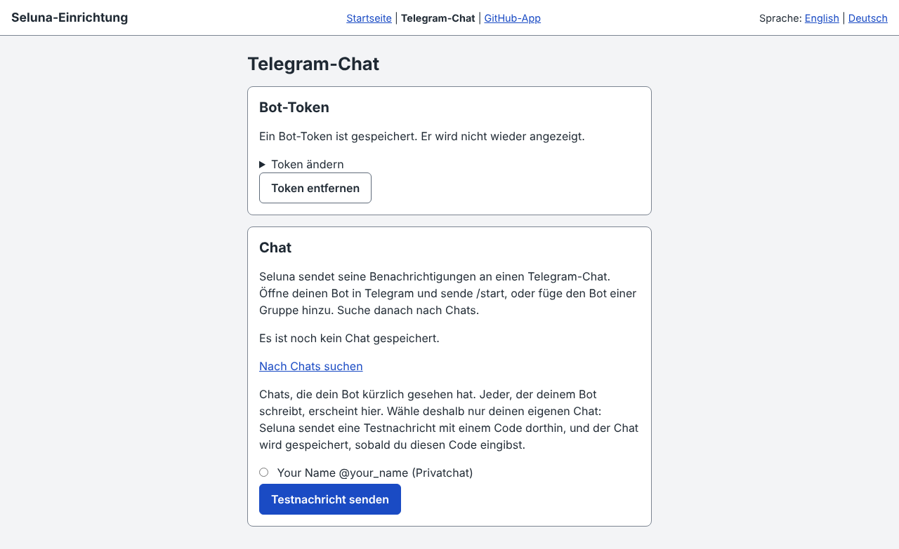

4. Seluna sendet eine Nachricht mit einem sechsstelligen Code an diesen Chat. Gib den Code in das Feld **Code** ein und wähle **Chat speichern**.

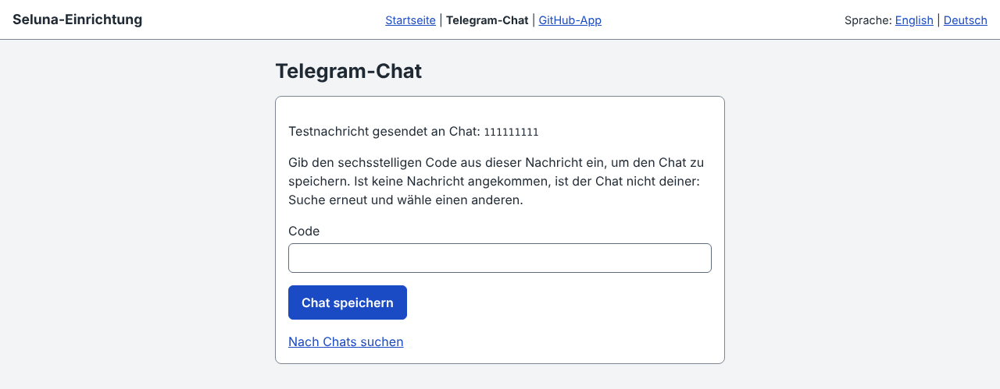

**Es hat geklappt, wenn** der Schritt **Gespeicherter Chat:** mit der Nummer deines Chats zeigt und die Startseite die Nummer neben **Telegram-Chat:** zeigt. Der Code beweist, dass der Chat dir gehört; ist keine Nachricht angekommen, ist es nicht dein Chat.

Wenn du den Token oder den Chat stattdessen von Hand als Worker-Secrets setzen möchtest, siehe [Worker secrets](areas/deployment.md#worker-secrets) (englisch).

## 6. GitHub-App erstellen

Seluna empfängt die Ereignisse deiner Repositories über eine eigene, private GitHub-App. Die Einrichtung erstellt sie für dich. Wähle oben auf der Seite **GitHub-App**.

1. Wähle **Mein persönliches Konto**, gib deinen GitHub-Benutzernamen in das Feld **Name des Kontos oder der Organisation, wie in github.com/name** ein und wähle **Weiter**. (Die Seite bietet auch **Eine Organisation** an; diese Anleitung geht vom persönlichen Konto aus.)

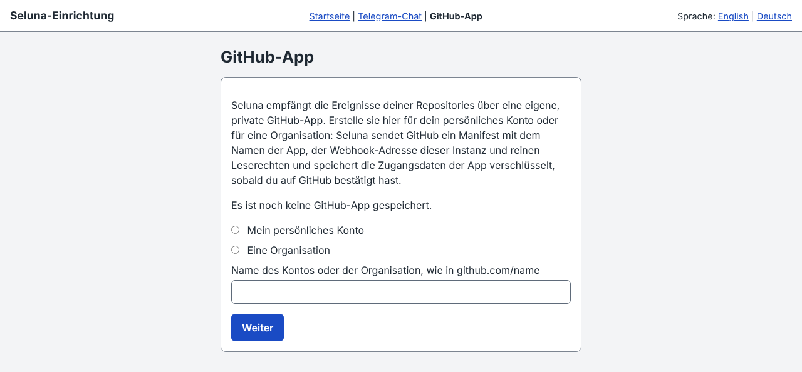

2. Seluna zeigt, worum es GitHub bittet: den Namen der App (`seluna-` und dein Kontoname), Berechtigungen nur zum Lesen und die Ereignisse, die sie abonniert. Wähle **Weiter zu GitHub**.

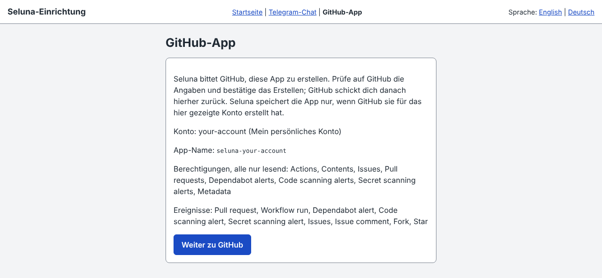

3. GitHub zeigt die Angaben der App. Prüfe sie, ändere auf Wunsch den Namen der App und bestätige das Erstellen. GitHub beschreibt das in seiner Dokumentation zum [Registrieren einer GitHub-App](https://docs.github.com/en/apps/creating-github-apps/registering-a-github-app/registering-a-github-app) (englisch).
4. GitHub schickt dich zur Einrichtung zurück. Wähle **Abschließen**: Seluna ruft die Zugangsdaten der App ab und speichert sie verschlüsselt.

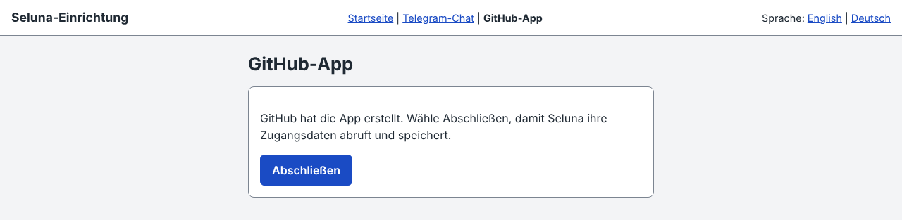

Tu das innerhalb einer Stunde und solange du auf der Einrichtungsseite angemeldet bist. Sonst lehnt Seluna die Rückkehr ab und es wird nichts gespeichert ([Fehlerbehebung](troubleshooting.md#the-return-from-github-is-refused)). Eine erneut erstellte App ersetzt die gespeicherte; lösche die alte App danach auf GitHub.

**Es hat geklappt, wenn** die Seite **Die GitHub-App ist gespeichert.** sagt und den Link **App auf GitHub installieren** anbietet.

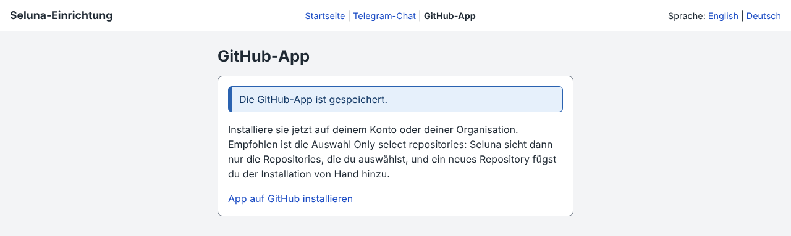

## 7. App auf einem Test-Repository installieren

Die App sieht nur die Repositories, die du ihr gibst. Seluna empfiehlt **Only select repositories**: Nur die Repositories, die du auswählst, melden an Seluna, und ein neues Repository fügst du der Installation von Hand hinzu.

1. Erstelle auf GitHub ein neues privates Repository mit einer README, zum Beispiel mit dem Namen `seluna-test` ([Dokumentation](https://docs.github.com/en/repositories/creating-and-managing-repositories/creating-a-new-repository), englisch).
2. Wähle auf der Einrichtungsseite **App auf GitHub installieren**. Die Seite von GitHub zum Installieren einer App öffnet sich ([Dokumentation](https://docs.github.com/en/apps/using-github-apps/installing-your-own-github-app), englisch).
3. Installiere die App auf deinem Konto nur für das Test-Repository, nicht für alle Repositories.
4. Gehe zurück zur Einrichtungsseite und wähle oben **Startseite**.

**Es hat geklappt, wenn** die Karte **Status** unter **Installationen:** dein Konto mit **persönliches Konto**, **ausgewählte Repositories** auflistet und nach **Besitzer der GitHub-App:** dein Konto zeigt. Nennt sie etwas unter **Fehlt der App:** oder ist die Installation mit **fehlt:** markiert, ergänze und akzeptiere es über ihre Links auf GitHub.

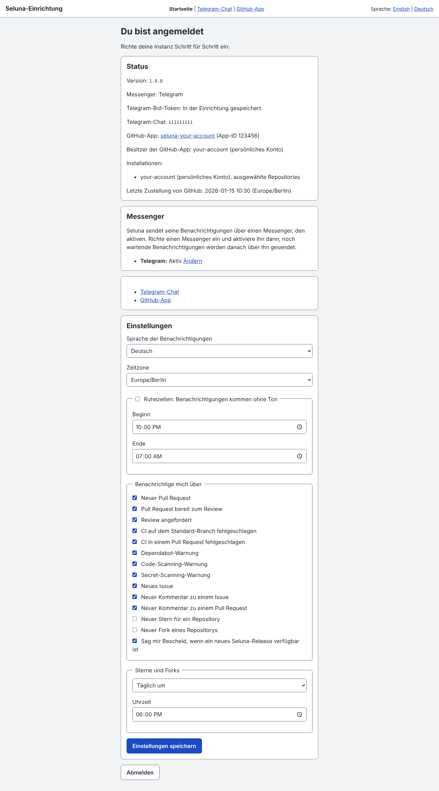

## 8. Einstellungen prüfen

Unter Status und Messenger zeigt die Startseite die Karte **Einstellungen**. Prüfe diese und wähle **Einstellungen speichern**:

- **Sprache der Benachrichtigungen**: English oder Deutsch.
- **Zeitzone**: UTC, bis du sie änderst; wähle deine.
- **Ruhezeiten: Benachrichtigungen kommen ohne Ton**: Setze den Haken und lege **Beginn** und **Ende** fest, wenn du nachts Nachrichten ohne Ton möchtest. Sie kommen trotzdem an.
- **Benachrichtige mich über**: ein Schalter je Art von Nachricht. **Neuer Stern für ein Repository** und **Neuer Fork eines Repositorys** sind aus, bis du sie einschaltest; **Sterne und Forks** legt fest, ob sie sofort, stündlich oder täglich kommen.
- **Sag mir Bescheid, wenn ein neues Seluna-Release verfügbar ist**.

Issues und Kommentare, die du selbst geschrieben hast, werden ausgelassen. Seluna weiß, wer du bist, sobald die Statusseite den **Besitzer der GitHub-App:** zeigt; öffne die Startseite nach der Installation einmal. Ein Pull Request, den du selbst öffnest, wird gemeldet, dein Test in Schritt 9 ergibt also eine Nachricht.

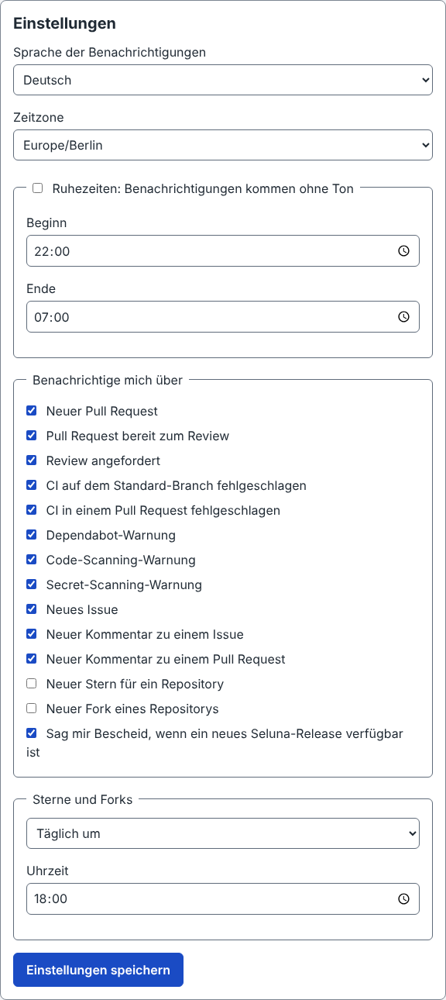

**Es hat geklappt, wenn** du die Seite neu lädst und die Einstellungen die gespeicherten Werte zeigen.

## 9. Mit einem Pull Request testen

1. Öffne auf GitHub das Test-Repository aus Schritt 7 und ändere in der Weboberfläche eine Zeile seiner `README.md` in einem neuen Branch ([Dokumentation](https://docs.github.com/en/repositories/working-with-files/managing-files/editing-files), englisch).
2. Öffne von diesem Branch aus einen Pull Request ([Dokumentation](https://docs.github.com/en/pull-requests/collaborating-with-pull-requests/proposing-changes-to-your-work-with-pull-requests/creating-a-pull-request), englisch). Öffne ihn als normalen Pull Request, nicht als Entwurf: Ein Entwurf-Pull-Request ergibt keine Nachricht.

**Es hat geklappt, wenn** Telegram von deinem Bot eine Nachricht **New pull request** (**Neuer Pull Request**, wenn du die **Sprache der Benachrichtigungen** auf Deutsch gestellt hast) mit dem Repository, dem Titel deines Pull Requests und einem Button zum Öffnen zeigt. Auf der Startseite zeigt **Letzte Zustellung von GitHub:** dann die Uhrzeit. Deine Instanz ist eingerichtet.

Kommt keine Nachricht an, listet die [Fehlerbehebung](troubleshooting.md#no-message-arrives) (englisch) die Ursachen auf, die günstigste zuerst.

## Updates

Jeder Push auf `main` deiner Kopie baut und deployt sie. Um ein neues Seluna-Release auf deine Kopie anzuwenden, starte den Update-Workflow in der Weboberfläche von GitHub; [Update](update.md) (englisch) erklärt, wie, und was bei Konflikten und Berechtigungen zu tun ist.

## Deinstallation

Um deine Instanz zu entfernen, lösche sie in der Reihenfolge unten. Seluna speichert nichts an anderer Stelle: Beim Löschen gehen die gespeicherten Zugangsdaten der GitHub-App und das Bot-Token verloren, der Telegram-Chat und deine Einstellungen, noch nicht gesendete Benachrichtigungen, die für eine noch nicht gesendete Zusammenfassung gesammelten Sterne und Forks sowie die Worker-Secrets. Eine neue Instanz bedeutet, die ganze Einrichtung noch einmal zu machen.

1. Öffne die Webadresse deines Seluna-Workers, die du für die Einrichtung benutzt hast, und melde dich mit deinem `SELUNA_SECRET` an. Die Startseite zeigt die App nach **GitHub-App:**; notiere sie. Deinstalliere sie auf GitHub von deinem Konto und lösche sie dann. GitHub sendet seine Zustellungen nur über diese App, danach erreicht nichts mehr Seluna ([Dokumentation](https://docs.github.com/en/apps/maintaining-github-apps/deleting-a-github-app), englisch).
2. Lösche bei Cloudflare den Worker und danach seine D1-Datenbank. Solange der Worker existiert, sendet er weiter: Er wiederholt ausstehende Nachrichten und sendet Zusammenfassungen und Release-Hinweise.
3. Sende in Telegram `/deletebot` an [@BotFather](https://t.me/BotFather) und wähle deinen Bot.
4. Lösche auf GitHub die Kopie des Repositorys aus Schritt 3 und, falls du eines erstellt hast, das Test-Repository aus Schritt 7. Tu das nach dem Worker: Bis dahin deployt ein Push auf die Kopie den Worker erneut ([Dokumentation](https://docs.github.com/en/repositories/creating-and-managing-repositories/deleting-a-repository), englisch).

Ein Schritt ist optional:

- Entferne den Zugriff von Cloudflare auf dein GitHub-Konto, wenn ihn nichts anderes nutzt ([Dokumentation](https://developers.cloudflare.com/workers/ci-cd/builds/git-integration/github-integration/), englisch). Das Formular in Schritt 3 hat ihn verbunden.

Wenn du den Worker vor der App gelöscht hast, lösche die App jetzt.

## Wenn etwas nicht funktioniert

Die [Fehlerbehebung](troubleshooting.md) (englisch) ist nach Symptomen geordnet: keine Nachricht, Anmeldung, der Telegram-Schritt, der GitHub-App-Schritt, die Webhook-Zustellungen von GitHub.
