# Setup

Deutsch: [Einrichtungsanleitung](setup.de.md)

How to set up your own Seluna instance, in your web browser and with the Telegram app on your phone. You type no command. If a step does not work, [Troubleshooting](troubleshooting.md) has the symptom.

## What you need

- A desktop web browser and the Telegram app on your phone.
- A free account at [GitHub](https://github.com/signup), at [Cloudflare](https://dash.cloudflare.com/sign-up) and at [Telegram](https://telegram.org/). A personal GitHub account is what this guide follows.
- A password manager, or another place where you can keep a long random password.

## 1. Create the Telegram bot

Seluna sends its notifications through a Telegram bot of your own.

1. In Telegram, open [@BotFather](https://t.me/BotFather) and send `/newbot`.
2. Answer its questions: a name for the bot, then a username that ends in `bot`.
3. Copy the token that @BotFather returns and keep it for step 5. Treat it like a password.
4. Open your new bot and send it `/start`. The bot does not answer: Seluna only sends messages, it never replies in Telegram.

Telegram describes this step in its [documentation on @BotFather](https://core.telegram.org/bots/features#botfather).

**It worked when** @BotFather has sent you a message with the bot's token.

## 2. Create the SELUNA_SECRET

`SELUNA_SECRET` is the password of your instance's setup page, and the key that encrypts the credentials Seluna stores comes from it.

1. In your password manager, generate a random password of at least 32 characters, for example 40 letters and digits. A shorter one is refused.
2. Save it in the password manager, for example as an entry named "Seluna".

Keep it: if you change it later, Seluna can no longer read what it stored, and you run parts of the setup again ([Troubleshooting](troubleshooting.md#i-changed-the-seluna_secret)).

**It worked when** you have a random password of at least 32 characters saved in your password manager.

## 3. Deploy to Cloudflare

1. Open the [README](../README.md) and select **Deploy to Cloudflare**.
2. Sign in to Cloudflare. The form asks you to connect your GitHub account, so that it can create a new private repository there with a copy of Seluna (an independent copy, not a fork). Cloudflare describes this in its [documentation on deploy buttons](https://developers.cloudflare.com/workers/platform/deploy-buttons/).
3. Keep the project name `seluna`, let the form create a new D1 database and name it `seluna`, and leave the location on automatic. Paste the password from step 2 where the form asks for `SELUNA_SECRET`, then continue until Cloudflare builds and deploys the Worker.
4. When the deploy has finished, check the deploy command in the Worker's build settings. It must be `npm run deploy`, which creates the database tables before it deploys the Worker. The button sometimes sets `npx wrangler deploy` instead; then change it to `npm run deploy` and retry the latest build. Cloudflare describes the build settings in its [documentation on build configuration](https://developers.cloudflare.com/workers/ci-cd/builds/configuration/).
5. Write down the address of your Worker, `https://<worker>.<your-subdomain>.workers.dev`; the Worker's page in the Cloudflare dashboard shows it.

Do not test Seluna in this copy of the repository: every merge into its `main` branch deploys your instance again.

**It worked when** the build log of the latest build shows the line `> wrangler d1 migrations apply DB --remote`, and `https://<worker>.<your-subdomain>.workers.dev/health` answers with the version of Seluna.

## 4. Open the setup page and sign in

1. Open `https://<worker>.<your-subdomain>.workers.dev/` in your browser. It leads to the setup page. The links at the top right, **English** and **Deutsch**, switch the language of the pages.
2. Enter your `SELUNA_SECRET` in the field **SELUNA_SECRET** and select **Sign in**.

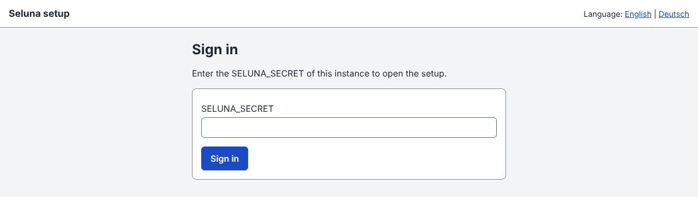

If you sign in wrongly five times, signing in is locked for 15 minutes ([Troubleshooting](troubleshooting.md#signing-in-is-locked)).

**It worked when** the page "You are signed in" opens, with the cards **Status** and **Messengers** and the links **Telegram chat** and **GitHub App**.

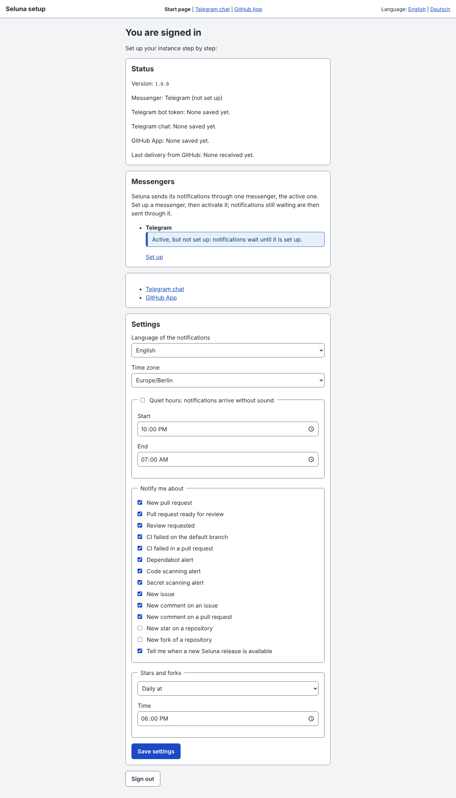

## 5. Connect the Telegram chat

Select **Telegram chat** at the top of the page.

1. Enter the bot token from step 1 in the field **Bot token** and select **Save token**. Seluna checks the token with Telegram and saves it encrypted; it is not shown again.

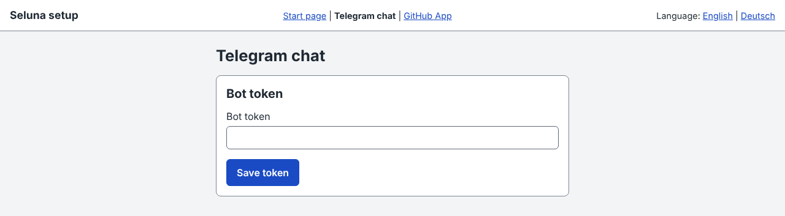

2. The step now lists the chats your bot has seen. Your own chat, named as in Telegram and marked **Private chat**, appears because you sent `/start` in step 1. If the list is empty (the page then says _No chat found_), send `/start` to your bot again and select **Search for chats**. Anyone who messages your bot appears here, so choose only your own chat.
3. Select your chat and select **Send test message**.

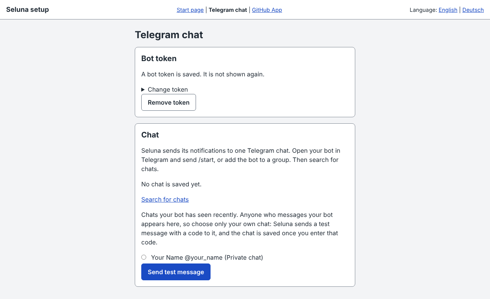

4. Seluna sends a message with a six-digit code to that chat. Enter the code in the field **Code** and select **Save chat**.

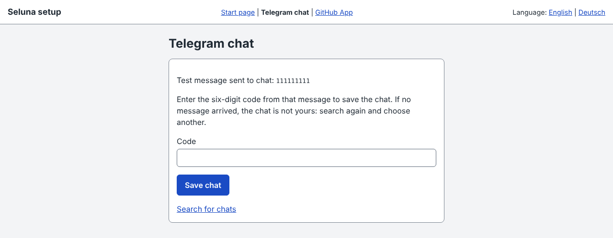

**It worked when** the step shows **Saved chat:** with the number of your chat, and the start page shows the number next to **Telegram chat:**. The code proves that the chat is yours; if no message arrived, the chat is not yours.

If you want to set the token or the chat by hand as Worker secrets instead, see [Worker secrets](areas/deployment.md#worker-secrets).

## 6. Create the GitHub App

Seluna receives the events of your repositories through a private GitHub App of its own. The setup creates it for you. Select **GitHub App** at the top of the page.

1. Select **My personal account**, enter your GitHub user name in the field **Name of the account or organization, as in github.com/name** and select **Next**. (The page also offers **An organization**; this guide follows the personal account.)

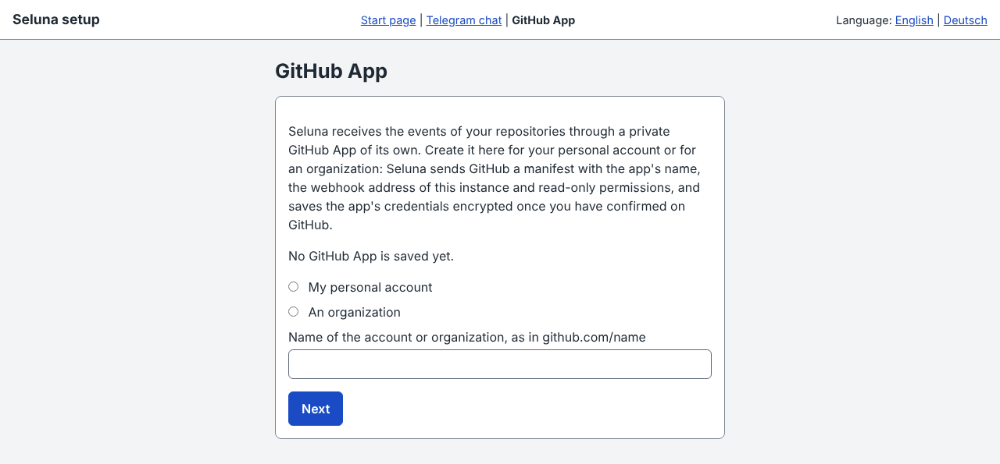

2. Seluna shows what it will ask GitHub for: the app's name (`seluna-` and your account name), read-only permissions and the events it subscribes to. Select **Continue to GitHub**.

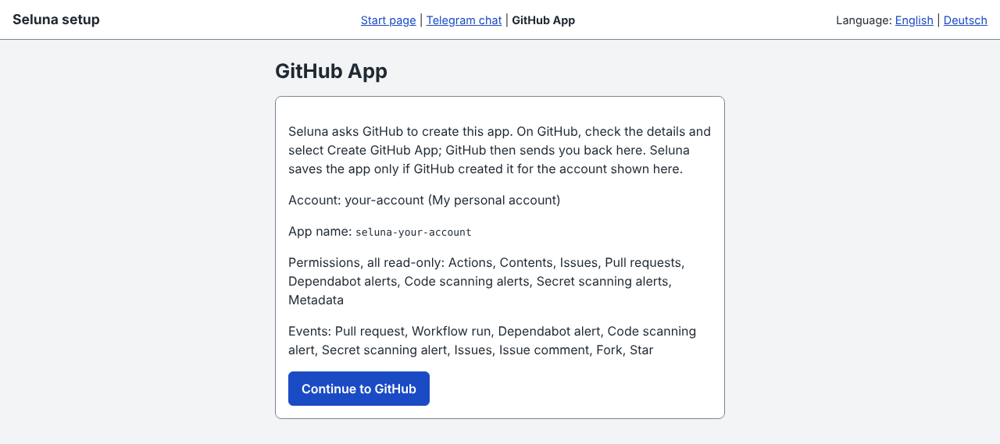

3. GitHub shows the app's details. Check them, change the app's name if you wish, and confirm the creation. GitHub describes this in its documentation on [registering a GitHub App](https://docs.github.com/en/apps/creating-github-apps/registering-a-github-app/registering-a-github-app).
4. GitHub sends you back to the setup. Select **Finish**: Seluna fetches the app's credentials and saves them encrypted.

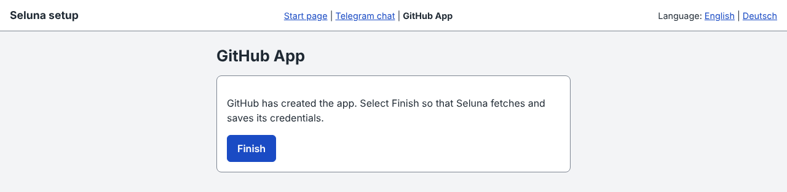

Do this within one hour, and while you are still signed in to the setup page. Otherwise Seluna refuses the return and nothing is saved ([Troubleshooting](troubleshooting.md#the-return-from-github-is-refused)). Creating the app again replaces the saved one; delete the old app on GitHub afterwards.

**It worked when** the page says **The GitHub App is saved.** and offers the link **Install the app on GitHub**.

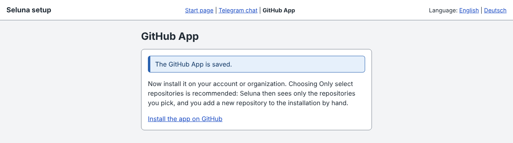

## 7. Install the app on a test repository

The app sees only the repositories you give it. Seluna recommends **Only select repositories**: only the repositories you pick report to Seluna, and you add a new repository to the installation by hand.

1. On GitHub, create a new private repository with a README, for example named `seluna-test` ([documentation](https://docs.github.com/en/repositories/creating-and-managing-repositories/creating-a-new-repository)).
2. In the setup page select **Install the app on GitHub**. GitHub's page for installing an app opens ([documentation](https://docs.github.com/en/apps/using-github-apps/installing-your-own-github-app)).
3. Install the app on your account for only the test repository, not for all repositories.
4. Go back to the setup page and select **Start page** at the top.

**It worked when** the **Status** card lists **Installations:** with your account, **personal account**, **selected repositories**, and shows your account after **GitHub App owner:**. If it names something under **Missing on the app** or marks the installation **missing**, follow its links to add and accept it on GitHub.

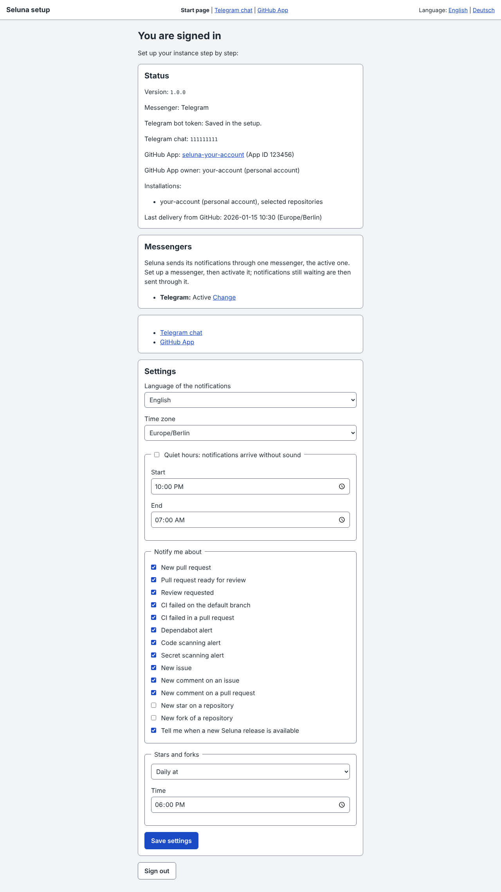

## 8. Review the settings

Below the status and the messengers, the start page shows the card **Settings**. Check these and select **Save settings**:

- **Language of the notifications**: English or Deutsch.
- **Time zone**: UTC until you change it; choose yours.
- **Quiet hours: notifications arrive without sound**: tick it and set **Start** and **End** if you want messages without sound at night. They still arrive.
- **Notify me about**: one switch per kind of message. **New star on a repository** and **New fork of a repository** are off until you turn them on; **Stars and forks** sets whether they come immediately, hourly or daily.
- **Tell me when a new Seluna release is available**.

Issues and comments you wrote yourself are left out. Seluna knows who you are once the status page shows the **GitHub App owner:**; open the start page once after the installation. A pull request you open yourself is reported, so your test in step 9 gives a message.

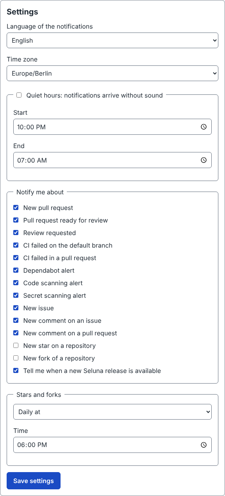

**It worked when** you reload the page and the settings show the values you saved.

## 9. Test with a pull request

1. On GitHub, open the test repository from step 7 and change a line of its `README.md` in a new branch, in the web interface ([documentation](https://docs.github.com/en/repositories/working-with-files/managing-files/editing-files)).
2. Open a pull request from that branch ([documentation](https://docs.github.com/en/pull-requests/collaborating-with-pull-requests/proposing-changes-to-your-work-with-pull-requests/creating-a-pull-request)). Open it as a normal pull request, not as a draft: a draft pull request gives no message.

**It worked when** Telegram shows a message **New pull request** (**Neuer Pull Request** if you set the **Language of the notifications** to Deutsch) from your bot, with the repository, the title of your pull request and a button that opens it. On the start page, **Last delivery from GitHub:** then shows the time. Your instance is set up.

If no message arrives, [Troubleshooting](troubleshooting.md#no-message-arrives) lists the causes, cheapest first.

## Updates

Every push to `main` of your copy builds and deploys it. To apply a new Seluna release to your copy, run the update workflow in GitHub's web interface; [Update](update.md) explains how, and what to do about conflicts and permissions.

## Uninstall

To remove your instance, delete it in the order below. Seluna keeps nothing anywhere else: deleting it loses the GitHub App's stored credentials and the bot token, the Telegram chat and your settings, notifications not yet sent, the stars and forks collected for a digest not yet sent, and the Worker secrets. A new instance means the whole setup again.

1. Open the web address of your Seluna Worker, the one you used for the setup, and sign in with your `SELUNA_SECRET`. The start page shows the app after **GitHub App:**; note it. On GitHub, uninstall it from your account, then delete it. GitHub sends its deliveries only through this app, so nothing reaches Seluna afterwards ([documentation](https://docs.github.com/en/apps/maintaining-github-apps/deleting-a-github-app)).
2. In Cloudflare, delete the Worker, then its D1 database. Until the Worker is gone, it keeps sending: it retries pending messages and sends digests and release notices.
3. In Telegram, send `/deletebot` to [@BotFather](https://t.me/BotFather) and choose your bot.
4. On GitHub, delete the copy of the repository from step 3, and the test repository from step 7 if you made one. Do this after the Worker: until then a push to the copy deploys the Worker again ([documentation](https://docs.github.com/en/repositories/creating-and-managing-repositories/deleting-a-repository)).

One step is optional:

- If nothing else uses it, remove Cloudflare's access to your GitHub account ([documentation](https://developers.cloudflare.com/workers/ci-cd/builds/git-integration/github-integration/)). The deploy form in step 3 connected it.

If you deleted the Worker before the app, delete the app now.

## If something does not work

[Troubleshooting](troubleshooting.md) is organized by symptom: no message, signing in, the Telegram step, the GitHub App step, GitHub's webhook deliveries.
